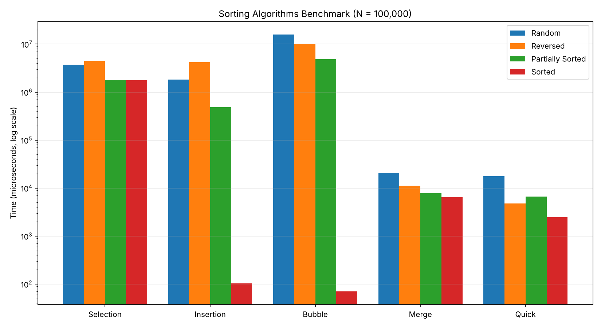

# Sorting-Algorithms-Benchmark

## بيانات الطالب
- الاسم: عبدالسلام انيس
- رقم القيد: 3169065

## وصف المشروع
برنامج بلغة Java يقيس زمن تنفيذ خمس خوارزميات ترتيب بالميكروثانية (µs):
Selection Sort, Insertion Sort, Bubble Sort, Merge Sort, Quick Sort.

حجم البيانات N = 100,000، وجربت كل خوارزمية على 4 حالات:
- عشوائية (Random)
- مرتبة عكسياً (Reversed)
- مرتبة جزئياً بنسبة 80% تقريباً (Partially Sorted)
- مرتبة تماماً (Sorted)

قبل كل تجربة آخذ نسخة جديدة من المصفوفة الأصلية حتى تبدأ كل خوارزمية بنفس البيانات، وأقيس زمن الترتيب فقط بـ `System.nanoTime()` ثم أقسم على 1000.

## جدول النتائج (بالميكروثانية µs)

| الخوارزمية | عشوائية (Random) | مرتبة عكسياً | مرتبة جزئياً | مرتبة تماماً |
|---|---|---|---|---|
| Selection Sort | 3,745,322 | 4,450,794 | 1,806,398 | 1,754,695 |
| Insertion Sort | 1,830,700 | 4,189,803 | 482,130 | 104 |
| Bubble Sort | 15,979,811 | 10,155,460 | 4,866,154 | 70 |
| Merge Sort | 20,315 | 11,250 | 7,843 | 6,489 |
| Quick Sort | 17,671 | 4,762 | 6,721 | 2,482 |

## الرسم البياني
(محور الزمن بمقياس لوغاريتمي لأن الفرق بين الخوارزميات كبير جداً)

## تحليل ومناقشة النتائج

### 1) الفرق بين O(N²) و O(N log N)
خوارزميات Selection و Insertion و Bubble تحتاج تقريباً N×N عملية، يعني حوالي 10 مليار عملية عند N = 100,000، ولذلك أخذت من ثانية إلى 16 ثانية في الحالات العشوائية.
أما Merge و Quick فتحتاج تقريباً N×log N، يعني حوالي 1.7 مليون عملية فقط، فانتهت في أجزاء من الثانية (حوالي 20 ملي ثانية أو أقل).
مثلاً في الحالة العشوائية: Bubble أخذت 15,979,811 µs و Merge أخذت 20,315 µs، يعني Merge أسرع بحوالي 780 مرة.

### 2) أفضل خوارزمية في الحالة المرتبة جزئياً والمرتبة تماماً
- في الحالة المرتبة تماماً كانت Insertion (104 µs) و Bubble (70 µs) الأسرع بفارق كبير، لأن الاثنتين تحتاجان مروراً واحداً فقط على المصفوفة (O(N)).
  Bubble عندي فيها متغير `swapped` يوقفها مباشرة إذا ما صار أي تبديل.
- في الحالة المرتبة جزئياً أفضل خوارزمية من الثلاث البطيئة هي Insertion Sort (482,130 µs)، لأنها تحرك العناصر الغلط فقط وتترك العناصر المرتبة في أماكنها، وهي أسرع من Selection بحوالي 4 مرات ومن Bubble بحوالي 10 مرات.
- لكن بشكل عام Quick و Merge تبقى الأسرع في كل الحالات تقريباً.

أما Selection Sort فزمنها قريب من بعض في كل الحالات لأنها دائماً تعمل نفس عدد المقارنات (N²/2) حتى لو كانت المصفوفة مرتبة. الفروقات البسيطة بين حالاتها سببها على الأغلب المعالج (توقع الفروع) والـ JVM وليس الخوارزمية نفسها.

### 3) سلوك Quick Sort واختيار عنصر المحور (Pivot)
Quick Sort تعتمد على اختيار المحور وتقسيم المصفوفة حوله.
- لو اخترت المحور أول عنصر أو آخر عنصر، وكانت المصفوفة مرتبة أو مرتبة عكسياً، يكون المحور دائماً أصغر أو أكبر عنصر، فيصير التقسيم غير متوازن (جهة فيها N-1 عنصر وجهة فارغة). هنا تنزل الخوارزمية إلى O(N²) وممكن يصير `StackOverflowError` لأن عمق الاستدعاءات يصل إلى 100,000.
  لاحظت هذا في تجربتي الأولى على 10,000 عنصر، حيث كانت Quick Sort بطيئة جداً في الحالة العكسية والمرتبة (42,591 و 76,929 µs) مقارنة بالجزئية (497 µs).
- لحل المشكلة جعلت المحور هو **العنصر الأوسط**. في المصفوفة المرتبة أو العكسية العنصر الأوسط هو الوسيط، فيصير التقسيم متساوياً تقريباً (نصف ونصف)، وبالتالي بقيت Quick Sort O(N log N) وكانت النتائج: 4,762 µs في العكسية و 2,482 µs في المرتبة.
